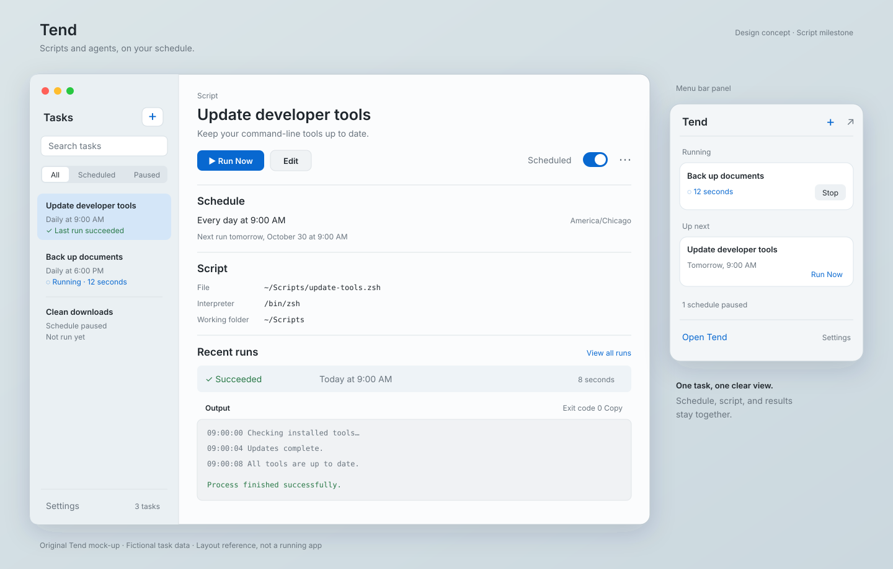

# Tend UI direction

[Open the full-size mock-up](design/tend-main-window.svg).

This original, editable SVG is the visual reference for Tend's first implementation. It uses fictional tasks and output. It is a design concept, not a running app.

## Main window

Use a native split view with a searchable task sidebar and a selected-task detail area. Start around 1000 by 728 points, with a resizable 240-point sidebar. Validate these dimensions in SwiftUI.

Task rows show name, schedule, and last result. Keep schedule state separate from execution state: a paused task may have a successful last run. Filters are All, Scheduled, and Paused.

The detail area keeps Run Now, Edit, the schedule toggle, the script configuration, and recent runs together. Put Delete in the overflow menu. Show Stop during execution, then Stopping until the runner confirms termination. Disable duplicate manual starts for the same task in the first version.

Use a selectable, monospaced output area. A selected run shows its timestamps, duration, exit status, stdout, and stderr. The mock-up shows a successful run; failures use a descriptive message and an action to inspect the output.

## Add and edit

Use a native sheet with Name, Script File, Interpreter, Arguments, Working Folder, and Schedule. Provide file and folder pickers. Schedule starts with Manual or Daily at a selected local time, with the time zone visible.

Save does not execute the task. Run Now is a separate explicit action. Put validation beside the affected field. Keep advanced environment settings collapsed.

When AI tasks arrive, add a Script / AI Prompt selector. AI tasks use Prompt, Runner, and Model in place of script fields, while retaining working folder and schedule. Explain unavailable runners and hide model selection when unsupported. AI controls are outside the first script milestone.

## Menu bar panel

The panel offers a quick view of active runs and upcoming tasks, with Run Now and Stop controls. Add Task and Open Tend lead to the main window. The header remains visible while content scrolls. Editing and full logs belong in the main window.

The mock-up uses a compact 312-point panel. Test between 312 and 360 points with long task names and larger text. Closing either window does not pause schedules.

## Native appearance

AIU is the family reference for native Mac materials and compact controls. Use the system font, primary and secondary text styles, the user's accent color, and semantic status colors. Pair every status color with an icon and a label.

The SVG's blue accent and light palette illustrate one appearance; implementation follows system preferences. Reserve monospaced text for scripts, paths, and output. Start with a 4, 8, 12, 16, 24-point spacing scale.

Use glass sparingly on supported window chrome and controls. Prefer stable, readable material or solid backgrounds for logs and scrolling content. Support dark appearance, Increase Contrast, Reduce Transparency, and Reduce Motion. Choose the minimum macOS version separately and provide appropriate material fallbacks.

## Required states

- Empty: Add your first task, with an Add Task button.
- Never run: Not run yet.
- Running: elapsed time and Stop.
- Success: completion time and View Output.
- Failure: a concrete cause such as Script exited with code 1, with View Output and Run Again.
- Paused: Schedule paused, with manual execution still available.
- Missing executable: explain which file is unavailable and keep Edit accessible.

Use standard keyboard navigation, visible focus, labeled icon controls, and selectable output. Command-N adds a task and Command-F focuses search. Escape dismisses an editor only after handling unsaved changes.

## First implementation check

Exercise the complete workflow: add an updater script, run it, inspect output, schedule it daily, then pause the schedule. Capture light and dark appearances and each required state with fictional data. Verify long names and paths, scrolling, keyboard access, and larger text before finalizing sizes.

The SVG is a layout reference. Native controls and accessibility take precedence over matching its pixels.
